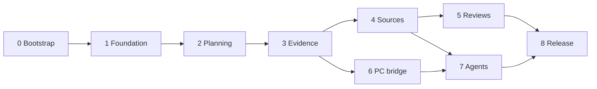

# Control Room Completion Implementation Plan

**Resumed current state (2026-10-19):** Phases0–7 have cloud-capable implementations. The actual separately reviewed private runtime is extracted and package-verified; public installer/coordinator/Windows ownership/cancellation/artifact/nonce recovery code passes focused real protocol and Windows tests. Exact3c canonical savep95 is1750.767601ms under the unchanged2000ms target; the slower performance experiment remains outside PR1. A proved fixture pool/deadline correction awaits final exact-source gates. Prior dated statements that runtime code, cloud execution or the source helper are missing are historical and superseded. Hosted/provider/device acceptance stays separate. Production cutover additionally requires a complete verified snapshot; the native database reader truncates the existing workspace, so no complete backup or new deployment is claimed. See progress.json and resume-checkpoint.json for current evidence.


> **For agentic workers:** Use `superpowers:subagent-driven-development` or `superpowers:executing-plans` when available. Execute the phase checklists, retain evidence, and update `progress.json`. The user requested this plan for later cloud implementation; the historical plan is followed by source-specific implementation and verification checkpoints below.

**Goal:** Complete every actionable gap in the 18 October 2026 Control Room audit: richer planning, durable recovery and evidence, current source information, useful automated reviews, PC visibility and controlled agent execution.

**Architecture:** Extend the existing private Sites-hosted Vinext/React application. Keep the bounded planning document and revision checks initially; move growing evidence, events, weekly history, connector state, telemetry and jobs into owner-scoped D1 tables. Store files and multi-version backups in R2. A separate enrolled Windows bridge makes outbound connections; long-running agents execute outside the request-serving Worker.

**Tech stack:** Existing React 19/TypeScript/Vinext/Vite, Zod, Drizzle, Cloudflare D1; proposed R2 binding `BUCKET`, IndexedDB only for explicitly enabled trusted-device storage, Node 24 test/runner environment, browser tests and the supported Sites delivery workflow. Use GPT-6.1 Sol implementation workers, following the earlier project implementation preference. Do not prescribe unavailable model IDs to external providers.

## Starting point

- Audited source: `b50aa5c34783ffc0109c46d91c599923df9cc305`, deployed version 2, 17 October 2026 at approximately 19:42 Africa/Cairo.
- Preserve the existing private Site identity and unchanged hosted configuration; its active version remains2 with effective owner-only access.
- Existing bindings: D1 `DB`; R2 currently `null`.
- Fresh audit checks: 71 tests, typecheck, lint and production build passed on 18 October. These are the baseline, not evidence for later changes.
- Historical seed/export counts are not migration inputs. Export the current owner workspace at implementation time and preserve its original records and identities.
- The audited local checkout had no configured remote. On 18 October the owner supplied `https://github.com/krybaby7/control-room` and explicitly approved publishing this source and plan there. Use that repository for cloud implementation; `docs/source-import.json` records imported source provenance. The original audited SHA is provenance and may not be a reachable commit in the new repository. The prepared source archive remains a fallback.
- Current authenticated browser inspection stopped at the owner's passkey. Earlier desktop failure/recovery tests are historical evidence. Recheck the intended hosted session during release validation.

## Definition of completion

Every row in `09-gap-coverage.md` must have implementation evidence and a passing acceptance check, or an explicit externally blocked/intentional boundary entry. A mocked connector, saved schedule, passing build, claimed agent result or offline PC is not a completed integration.

The cloud implementation can finish application code, schema, browser tests, adapters, fixtures and deployment packaging. The owner/local environment must supply any required provider consent, supported unattended credentials, Windows installation, passkey interaction and physical-device checks. Continue independent phases when one integration lacks access; keep that integration visibly disconnected.

A control room can collect and evaluate evidence; it cannot manufacture missing historical timestamps, prove an untested phone reliable, guarantee trading profits, or make an offline PC execute work. Those limits have explicit workflows in the coverage matrix. Live trading actions, public access and unrestricted remote shell execution are not enabled by this plan. Operational adapters are capability-scoped and require a separate concrete activation decision.

## Phase sequence

| Phase | User-visible result | Depends on | Cloud completion boundary |
|---|---|---|---|
| 0. Bootstrap and contracts | Reproducible baseline, shared contracts and migration rehearsal | Supplied source | Fully cloud-capable; account/tool access may be missing |
| 1. Foundation and recovery | Reconciled saves, recoverable drafts, safe imports, multiple backups and capacity recovery | 0 | Scheduled backup requires proven unattended writer and R2 |
| 2. Planning workflows | Manage projects, detailed milestones, dependencies, attention queues, search and weekly planning | 1 | Fully cloud-capable with isolated browser data |
| 3. Evidence and history | Structured evidence, attachments, decisions, change history and undo | 1, 2 | Hosted attachments require provisioned R2 |
| 4. Source synchronization | Current GitHub/documents/selected conversation evidence and change proposals | 1, 3 | Live provider reads and unattended access require real consent/access |
| 5. Reviews and automation | Freshness signals, project briefs, optional AI analysis and recurring reviews | 2, 3, 4 | Background runs and optional model calls require configured execution access/budget |
| 6. PC and runtime visibility | PC/resource health, project runtime observations and offline/stale labels | 1, 3; interface from 4 | Cloud builds protocol; real Windows enrollment/install is local |
| 7. Agent coordination | Bounded jobs, approvals, exact provider/model selection, artifacts, cancellation and reconciliation | 1, 3, 4; 6 for local runners | At least one real executor/provider must be configured and validated |
| 8. Release and verification | Tested private release, recoverable migration, current docs and operational handoff | All applicable phases | Authenticated/device/provider acceptance may require owner actions |

Each phase document is executable on its own after its prerequisites. The coordinating cloud worker owns shared types, migrations and integration. Parallelize independent leaf modules, not simultaneous edits to `lib/types.ts`, `lib/planning.ts`, `db/schema.ts`, migration journals or the central UI.



## Documents and ownership

| Document | Responsibility |
|---|---|
| [01-foundation-recovery.md](01-foundation-recovery.md) | Save/retry outcome model, transaction boundary, schema migrations, drafts, imports, backups, cleanup |
| [02-planning-workflows.md](02-planning-workflows.md) | Projects, tasks, milestones, dependencies, search, queues, recurrence, weekly capacity/reviews |
| [03-evidence-history.md](03-evidence-history.md) | Evidence objects, files, acceptance, decisions, audit history, conflict-aware undo |
| [04-source-synchronization.md](04-source-synchronization.md) | Provider adapters, GitHub, documents/conversations, ingestion, synchronization, proposal review |
| [05-reviews-automation.md](05-reviews-automation.md) | Freshness, evidence-linked briefs, AI assistance, schedule engine and in-app notifications |
| [06-pc-runtime.md](06-pc-runtime.md) | Windows bridge, enrollment, telemetry, local runtime adapter and offline behavior |
| [07-agent-coordination.md](07-agent-coordination.md) | External execution protocol, providers, models, policies, budgets, jobs and Agent Lab integration |
| [08-release-verification.md](08-release-verification.md) | CI, browser/device checks, performance, deployment, migration and recovery drills |
| [09-gap-coverage.md](09-gap-coverage.md) | Exhaustive audit-gap acceptance ledger |
| [CLOUD-START.md](CLOUD-START.md) | Copy-ready cloud launch prompt and source import instructions |
| [progress.json](progress.json) | Machine-readable checkpoint; never mark a phase complete from implementation alone |

## Architecture decisions

1. **Incremental extension is the chosen approach.** A rewrite would duplicate working authentication, persistence and recovery. Merely placing feeds on the current screen would leave the data/history limits unresolved. Extend the existing application with explicit modules and bounded migrations.
2. **Planning remains owner-controlled.** Imports and model analysis create evidence and proposals. Accepting an inference cannot silently complete a task, approve a milestone, pin a week, alter a goal or authorize execution. Explicit owner commands perform those changes.
3. **Growing data lives outside the planning JSON.** D1 modules own evidence, events, decisions, weeks, recurrence, observations, connector cursors, schedules and jobs. R2 stores immutable objects; D1 references their digest, size, owner and lifecycle state. The 1 MB document does not become an unbounded event log.
4. **Explicit mutation and revision domains.** Owner planning, weekly, evidence, decision, configuration and job create/approve/cancel/accept commands use Phase 1's owner-aware transaction/receipt boundary, including their related side writes. Telemetry, source observations/cursors, leases and job progress use owner-scoped operational CAS/sequence stores; they do not advance the editor's workspace revision or authorize planning changes. D1 batches roll back on statement failure, but a zero-row CAS is not a SQL error: every side write must be conditioned on the same successful claim/revision. Test the lost-CAS path explicitly. [D1 batch contract](https://developers.cloudflare.com/d1/worker-api/d1-database/).
5. **Schema versions are distinct.** Foundation owns planning schema v3; planning workflows introduce v4. Export bundle versions and each normalized module's versions are independent. Preserve v1/v2 import via deterministic migrations. Generating SQL sequence numbers remains the integrator's job; never rewrite the two existing applied migrations.
6. **R2 operations are not a D1 transaction.** Stage upload, verify digest, finalize metadata atomically, and reconcile abandoned objects. For backups, retain the old complete generation until the new manifest and all objects are verified. Never label a partial bundle restorable.
7. **Cloud services have explicit identities.** Private Sites access tokens alone do not grant a visitor identity or connected-app consent. Resolve owner/scope from a registered service principal or the independently enrolled device credential, never a body field or invented identity header. A short explicitly configured manual connection may rely on the documented confirmed owner-private Sites deployment boundary plus existing device authorization. Its local release cutoff is not an issuer expiry or renewable background authority. Prove both platform ingress and application authorization before enabling the corresponding calls.
8. **Do not assume provider capabilities.** The existing connector library has request-scoped server bindings. Discover eligibility, canonical connector/action schemas and permissions in the implementation environment. This planning session did not expose the Sites eligibility tool; that is unknown availability, not evidence that a connector is denied or supported.
9. **Use one bounded background job substrate.** Phase 4 introduces integration job/cursor primitives; Phase 5 adds schedules. Phase 7 adds separately typed agent jobs. The request-serving Worker admits/statuses work; it does not host long-running coding processes. Worker resource limits require bounded parsing and offloaded heavy extraction. [Worker limits](https://developers.cloudflare.com/workers/platform/limits/).
10. **Every module declares portable data.** Register owner export/import, schema, retention, indexing and deletion behavior when adding its tables. Export contains references and optional file payloads, not credentials, provider tokens, device keys or runnable approval grants. Restores pause schedules/jobs, invalidate old execution capabilities and require reconciliation before resuming.

## Phase 0 bootstrap checklist

**Existing files to inspect:** `README.md`, `.openai/hosting.json`, `package.json`, `lib/types.ts`, `lib/planning.ts`, `lib/workspace-store.ts`, `lib/workspace-validation.ts`, `app/api/workspace/route.ts`, `db/schema.ts`, `drizzle/`, `scripts/execution-profile.mjs`, `scripts/install-ci.mjs`, and the prior specs/verification records.

**Create during implementation:** `docs/implementation/control-room/{environment.md,contracts.md,decisions.md}`, `.github/workflows/control-room-ci.yml` only if a real GitHub repository is selected, and phase-specific verification records under `docs/superpowers/verification/`.

The bootstrap below is completed setup evidence, not a list of outstanding application work. Live deployment and device/provider acceptance remain separate requirements.

- [x] Selected repository and imported baseline provenance are recorded; frozen source and review-package byte identity were independently verified.
- [x] Cloud capability boundaries and configured GitHub/Actions identities were checked. Managed cloud command execution and the supported existing-Site source/package helper are restored; no original Windows checkout access is implied.
- [x] Node 24 and locked CI installation are established; original and expanded tests, typecheck, lint and build have actual cloud results.
- [x] Existing owner-private Sites metadata/source/deployment capability is verified. A complete pre-cutover snapshot remains unavailable through the truncated native DB reader; no new deployment is claimed.
- [x] Synthetic owner-isolation, migration-preservation, near-limit, legacy v1/v2 and malformed-input fixtures exist; production owner exports are not test inputs.
- [x] Owner-derived transaction, actor, export-registry, event and bounded route contracts are implemented and reviewed.
- [x] Phase-specific scripts and actual repository workflows are established; their results remain tied to exact source/run identities.
- [x] Plan, progress, verification and interruption checkpoints are maintained. Phase 0 setup is complete; this does not make later failed acceptance gates pass.

```bash
node --version
npm run install:ci
npm test
npm run typecheck
npm run lint
npm run build
git status --short
```

**Acceptance:** existing tests and build pass in the actual cloud profile; current source is pinned; synthetic migration fixtures exist; contracts are reviewed; no production data or connection settings changed. A missing GitHub remote does not prevent local commits or implementation. It does prevent claiming a GitHub PR/CI run exists.

## Integration and execution rules

- Implement task-by-task with a regression first for each material behavior; run targeted checks while working, then the phase suite. Use an independent reviewer for boundary-sensitive changes and final integration. Routine fixes need no additional conversational permission.
- Each phase ends with a reviewable commit or branch checkpoint and verification record. Progress through passing phases automatically; do not stop after every checkbox to ask whether to continue.
- Package and publish only coherent verified milestones through Sites. Preserve owner-only access. Resolve tool-required consent, destructive actions, new paid-provider spending, local installation or missing account access at the concrete step that needs it. Do not repeatedly ask about already-authorized implementation.
- No tests that complete, archive, delete, restore or duplicate the real production plan. Use isolated data and controlled staged accounts. Hosted read checks are safe; mutation drills use a designated test workspace.
- Do not apply existing proposals or invent commitments during implementation. Seed/demo fixtures never replace existing records.
- Keep integration settings and failure states visible: `disconnected`, `needs_connection`, `syncing`, `fresh`, `stale`, `failed`, `unsupported`. An empty successful feed is distinct from failure. A schedule with no proven execution path stays inactive.
- Use feature switches to stage incomplete adapters; a disabled stub is not a completed capability. Record exactly which real provider/device/worker was exercised, or why the live acceptance remains pending.
- Provider payloads, documents and AI results are untrusted data. They cannot issue commands, change allowed scopes or approve their own output.

## Suggested release milestones

| Release | Contents | Exit condition |
|---|---|---|
| Planning and trust | 1–3 | Current records preserved; workflow/recovery/history acceptance passes |
| Connected evidence | 4–5 | At least one real allowed source and one unattended review proven; disconnected sources labeled |
| PC visibility | 6 | Real enrolled Windows bridge observed online, offline, reconnected and revoked |
| Controlled execution | 7 | One bounded real job lifecycle, reconciliation and cancellation verified without unapproved effects |
| Completion acceptance | 8 | Gap ledger reconciled, all enabled capabilities evidenced, open external gates handed off explicitly |

Dates and effort are intentionally not fabricated. This is a substantial multi-release program. A cloud run should persist its checkpoint and continue the next phase rather than compressing the scope into superficial placeholders.

## Reference authority

Use current repository code to resolve existing behavior; use installed Sites/cloud skills and native tool schemas to resolve host integration. The linked GitHub/Cloudflare documentation was checked on 18 October 2026 and must be rechecked when implementing provider-specific behavior. The design decisions above are proposals for this completion program, not claims of existing features.


## Current cloud implementation checkpoint — 2026-10-19

Documentation prepared from clean source `eb6755432f3e0989b1c722ac56fe745b7f4a7102`; adjacent progress/checkpoint records resolve the next integrated source. The gap ledger and phase report retain exact tested-source attribution. This checkpoint does not certify that later source or its package.

Source-specific checks do not certify a later integrated checkout. At `296fd5654b8f457187cf12b4d5b9ab46044c8c03`, run39192051800 passed the native browser job117866794907 (63 Chromium and3 R2 journeys), targeted job117866794977 (3 budget/history/review journeys), and mobile job117866794902 (2 fixtures; maximum measured p95 2737.6ms). The run itself failed its complete Node job; those browser passes are not a full-run pass.

At `ce865844216cbce5a002bfd9fcdd33006daf4da6`, run39192352370 full job117867696715 passed1773/1773 tests with no skips in249056.284ms. Targeted job117867696557 passed107/107 plus typecheck and lint (0errors,8warnings). Budget-dialog scrolling, exact scoped history and deferred-panel recovery are source-verified internal fixes. At `706505ea697896637ad218ebd5f91e53fcb1f16f`, run39192869059/job117869259962 passed the actual 27-migration D1 historical-NULL/bulk-history,55-event pagination, owner-isolation and immutable-payload test (1/1,3047.719ms), typecheck and lint (0errors,8warnings).

The earlier unchanged normal performance gate at `1f465fdf5d55d05ea5e47d2d5241b502c8957a5e`, run39191640986/job117865534346, remains **FAILED**: D1 save p95 2503.521524ms exceeds 2000ms. SQLite p95 1009.058ms passed; both engines retained100 session outcomes, six restores and errors[]. Earlier e0bb normal D1 p95 1659.689439ms passed its own source/run; the separate2518.590607ms instrumented failure and all four earlier ABBA D1 failures remain historical evidence. No passing result is substituted for the current failed gate, and no validation cut or blind rerun is proposed.

- Final integrated exact-source Node/bridge/type/lint/build/nativeD1R2/HTTP/browser/mobile/performance and source/build-package gates remain pending. Earlier passes and packages retain their own source identities; no accepted final release artifact or deployment is claimed.
- The unchanged2s normal D1 save gate remains unmet. Preserve the complete hash, serialization, epoch, receipt and row-set checks while reporting this limitation.
- The existing private Site remains unchanged at version2 with effective owner-only access. Metadata/deployment access exists; supported source/package helper execution is unavailable. That helper blocker does not imply that the Site or deployment metadata is inaccessible.
- Separate runtime extraction/registration and actual Windows owned-process/sandbox integration code remain missing. Live provider consent, renewable private ingress, hosted stream/wakeup acceptance, owner PC/Task Scheduler installation, physical-device/offline/mobile and passkey checks require their actual environments. Cloud fixtures do not supply those results.
- Paid inference, operational/trading effects and external alerts remain disabled.

## Reviewed follow-up and current gate limits — 2026-10-19

Documentation prepared from clean source `eb6755432f3e0989b1c722ac56fe745b7f4a7102`. These are component/source-specific results; the final integrated checkout and package still need their own gates.

- At `3b170542115137b95b83f10b6c9e302af5c21e19`, full 1774/1774, bridge 146/146, typecheck, lint and build passed. Focused 489, native and segmented recovery proofs also passed; the segmented fixture retained 79 segments, 10080 rows and 17767591 bytes with a fenced target. Main run39193244377 nevertheless **FAILED** its first scheduled-source wake admission: the six-statement atomic batch exceeded D1's 100-binding ceiling. Earlier test passes do not convert that run into a pass.
- The reviewed atomic-admission fix retains all conditions, binding order and one guarded transaction, using one canonical JSON scalar vector and four guard bindings. At `d2d35c21515790ffe754ae4d84392c0341e7bf91`, run39194122483/job117873042518 passed 34/34 targeted tests and the original actual 27-migration D1 scheduled-source test: service admission, five-page restart/cursor, same-intent replay, lease expiry, private-capacity pauses, principal/device revocation, archive/epoch fences, rollback/retry and unchanged planning. Typecheck passed; lint reported 0 errors and 8 warnings. This is synthetic-adapter proof, not live provider activation.
- The reviewed focus changes capture the actual trigger before a deferred editor disables it, including the custom enrollment dialog. At `e5c302de83332a904b530d365d92b9404b704c3f`, run39193959740 passed all 11 original QA cases: Chromium job117872561129 (4/4), Firefox job117872560960 (3/3) and WebKit job117872561072 (4/4); typecheck, lint and build passed. The original 390/768/1280 viewport budget/enrollment Escape assertions were retained.
- The unchanged normal performance run39193244373 at 3b remains **FAILED**: D1 save p95 2410.695566ms exceeds 2000ms. SQLite p95 953.989ms passed; 100 session outcomes, six restores and errors[] were retained. This supersedes no earlier result: the 1f failure and earlier e0bb pass/ABBA failures remain recorded at their own sources.
- Mobile run39193244400 at the same 3b source **FAILED** the unchanged 3000ms budget at 3205ms; its other HTTP checks passed. Separate same-source run39193240126 **PASSED** at 2746.3ms. Keep both observations; the passing run does not erase the failure or establish final integrated performance.

No final integrated exact-source gate, accepted source/build package or new deployment is claimed. The existing private Site remains unchanged at version 2/effective owner-only. Metadata/deployment access exists; supported source/package helper execution remains unavailable. Separate runtime extraction/registration and Windows owned-process/sandbox integration code remain missing; provider, private ingress and actual owner-device acceptance remain external. Paid inference, operational/trading effects and external alerts stay disabled.

## Frozen-source verification — 2026-10-19

Current application source is `e4af1fc5ae344a029f9677576963700c92aaefee`; this documentation checkpoint does not change that source. Earlier results above retain their own source identities.

- Focused tests passed 491/491 with typecheck and lint (job117874233566). QA run39194510945 passed all 11 original cases: four Chromium, three Firefox and four WebKit.
- Both mobile runs at this same source passed 2/2: run39194510972/job117874244687 recorded p95 2761.9ms; run39194507161/job117874233407 recorded 2739.8ms. These do not erase the separately recorded 3b mobile failure.
- Stream tests (14), actual runtime D1, artifact tests (16) plus D1/R2, agents D1 and maintenance passed. Maintenance retained the 97-table/291-guard profile. Segmented run39194510962/job117874244413 passed with 27 migrations, 33 modules, 79 segments, 10080 rows and 17767591 bytes; the target remained fenced.
- Normal performance run39194510942/job117874255539 **FAILED only the unchanged D1 save p95 gate**: 2499.678949ms exceeds 2000ms (p50 1797.99ms). SQLite p95 978.53ms and D1 read 859.97ms passed. The run retained 100 outcomes, six restores and errors[]. Evidence artifact12161845635 has digest `325994989f843e4becbaa72d22b4f77751d0ee98619434ce99f068de4cedcfe4`. Prior 3b and earlier failures remain historical evidence; no passing source is substituted for this failed performance gate.
- **FINAL MAIN RUN FAILED:** run39194510987/job117874247405 passed 1776/1776 Node tests with zero skips/cancellations (312917.923094ms), 146 bridge tests, typecheck, lint, build and all native D1 fixtures, including original scheduled-source and runtime checks. Default attachment HTTP and attachment HTTP/R2 passed. The default browser suite passed 62/63: the budget case at agents.spec.ts:61 failed when the first GET /api/jobs after saving a budget returned a non-success status after approximately 15.4 seconds. The response was an empty 502 after approximately 15 seconds; its exact cause remains under investigation and the internal jobs-read acceptance gate is open. R2 browser tests separately passed 3/3 (52.2s). Bridge/candidate packaging steps were skipped, so this run produced no accepted candidate package. Failure artifact12161927116 has SHA-256 `34814a0c847b0876b44565b85571128ddb8c1b62f8437d51b7922d92c525c8e1`. Step advancement did not establish success; the terminal failure governs this run.

Runtime extraction/registration and Windows owned-process/sandbox invocation code remain missing. Actual provider consent, renewable private ingress and owner-device acceptance remain external checks. The existing private Site stays unchanged at version 2/effective owner-only: metadata/deployment access exists, while supported source/package helper execution remains unavailable. Paid inference, operational/trading effects and external alerts remain disabled. No final integrated acceptance, accepted source/build package or new deployment is claimed.

## Review packages and diagnostic status — 2026-10-19

Canonical application source remains `e4af1fc5ae344a029f9677576963700c92aaefee`. Its main run remains failed at 62/63 default browser cases: the jobs read returned an empty 502 after approximately 15 seconds. Its unchanged normal D1 save p95 remains 2499.678949ms, above the 2000ms gate. Other source-specific passes above remain valid; neither diagnostic work nor a review package changes these failures.

Independent exact-e4 **UNVALIDATED review packages** now exist for source, build and bridge. Integrity verification checked 1032 source files, 332 build files and 34 bridge files, plus two tamper controls. The complete evidence index is `verification-e4af1fc5.json`. These packages are available for review; they are not accepted release artifacts, a passing full gate or a deployment. The failed main run itself skipped packaging.

Corrected jobs diagnostic 9b98/run39197094431/job117882154116 TERMINAL SUCCESS: 1776 Node tests (309249.212968ms),146 bridge tests,typecheck/lint/build/all native checks;63/63 default browser (4.4m),3/3 R2 (51.2s) and HTTP passed. Captured351 closed events and25 GET /api/jobs requests: all200,headers29–72ms,all25 reader validations,no deadline/error. This is NONREPRODUCTION ONLY: no causal fix and no canonical-source pass. Profile diagnostic `20c9` finished with 19 contract tests, typecheck and lint passing, while its diagnostic p95 remained approximately 2360ms and failed the unchanged gate. Measured serializer CPU was 24.6–32.9ms; the SHA-promise union was 868–1049ms, with queue/service/resume inseparable. Truncated synchronous unions remain null, not zero or measured durations.

Native-SHA experiment817/run39198054055: contractsjob117884994482 passed41/41 (8085.558832ms),Worker parity,typecheck/lint/build/runtime27migrations. Normaljob117884994781 FAILED D1savep952976.172820ms>2000,p502244.327927ms;SQLite972.609903ms and D1read925.253108ms passed,100outcomes/sixrestores perengine/errors[]. Artifact12162961643 SHA25635fadef0b16c4051c9d38320e45a63238f11a481c7bb8d4b5a7a86b3ca46fc6c. Static review of462 files/100 client entries found no client path. DECISION: no integration,no improvement,no rerun;canonical e4 remains frozen.

Private runtime extraction/registration and Windows owned-process/sandbox invocation remain missing code, separate from owner installation and actual-device acceptance. Provider/device consent and supported helper execution remain unavailable; Site metadata/deployment access exists. Paid inference, execution/trading effects and external alerts remain off.
