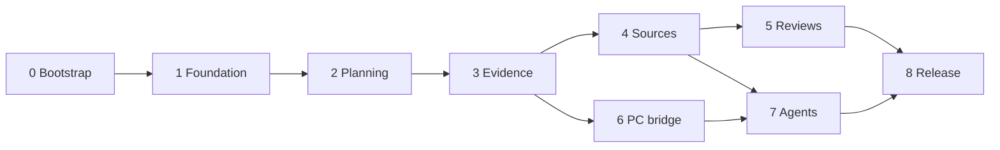

# Control Room Completion Implementation Plan

> **For agentic workers:** Use `superpowers:subagent-driven-development` or `superpowers:executing-plans` when available. Execute the phase checklists, retain evidence, and update `progress.json`. The user requested this plan for later cloud implementation; this document is not a record of completed implementation.

**Goal:** Complete every actionable gap in the 18 October 2026 Control Room audit: richer planning, durable recovery and evidence, current source information, useful automated reviews, PC visibility and controlled agent execution.

**Architecture:** Extend the existing private Sites-hosted Vinext/React application. Keep the bounded planning document and revision checks initially; move growing evidence, events, weekly history, connector state, telemetry and jobs into owner-scoped D1 tables. Store files and multi-version backups in R2. A separate enrolled Windows bridge makes outbound connections; long-running agents execute outside the request-serving Worker.

**Tech stack:** Existing React 19/TypeScript/Vinext/Vite, Zod, Drizzle, Cloudflare D1; proposed R2 binding `BUCKET`, IndexedDB only for explicitly enabled trusted-device storage, Node 24 test/runner environment, browser tests and the supported Sites delivery workflow. Use GPT-6.1 Sol implementation workers, following the earlier project implementation preference. Do not prescribe unavailable model IDs to external providers.

## Starting point

- Audited source: `b50aa5c34783ffc0109c46d91c599923df9cc305`, deployed version 2, 17 October 2026 at approximately 19:42 Africa/Cairo.
- Site identity: `appgprj_6ad38014b404819182d7d59170f460a7`; retain `.openai/hosting.json` and owner-private access.
- Existing host: https://adami-project-control-center.roundmoth32.chatgpt.site.
- Existing bindings: D1 `DB`; R2 currently `null`.
- Fresh audit checks: 71 tests, typecheck, lint and production build passed on 18 October. These are the baseline, not evidence for later changes.
- Last retained export: two projects, seven planned milestones, 20 proposed tasks, three captures, zero weekly commitments. Its revision 3 and update timestamp match the live metadata checked during the audit. Do not use these historical counts as migration inputs; export the current workspace at implementation time.
- The audited local checkout had no configured remote. On 18 October the owner supplied `https://github.com/krybaby7/control-room` and explicitly approved publishing this source and plan there. Use that repository for cloud implementation; `docs/source-import.json` records imported source provenance. The original audited SHA is provenance and may not be a reachable commit in the new repository. The prepared source archive remains a fallback.
- Current authenticated browser inspection stopped at the owner's passkey. Earlier desktop failure/recovery tests are historical evidence. Recheck the intended hosted session during release validation.

## Definition of completion

Every row in `09-gap-coverage.md` must have implementation evidence and a passing acceptance check, or an explicit externally blocked/intentional boundary entry. A mocked connector, saved schedule, passing build, claimed agent result or offline PC is not a completed integration.

The cloud implementation can finish application code, schema, browser tests, adapters, fixtures and deployment packaging. The owner/local environment must supply any required provider consent, supported unattended credentials, Windows installation, passkey interaction and physical-device checks. Continue independent phases when one integration lacks access; keep that integration visibly disconnected.

A control room can collect and evaluate evidence; it cannot manufacture missing historical timestamps, prove an untested phone reliable, guarantee trading profits, or make an offline PC execute work. Those limits have explicit workflows in the coverage matrix. Live trading actions, public access and unrestricted remote shell execution are not enabled by this plan. Operational adapters are capability-scoped and require a separate concrete activation decision.

## Phase sequence

| Phase | User-visible result | Depends on | Cloud completion boundary |
|---|---|---|---|
| 0. Bootstrap and contracts | Reproducible baseline, shared contracts and migration rehearsal | Supplied source | Fully cloud-capable; account/tool access may be missing |
| 1. Foundation and recovery | Reconciled saves, recoverable drafts, safe imports, multiple backups and capacity recovery | 0 | Scheduled backup requires proven unattended writer and R2 |
| 2. Planning workflows | Manage projects, detailed milestones, dependencies, attention queues, search and weekly planning | 1 | Fully cloud-capable with isolated browser data |
| 3. Evidence and history | Structured evidence, attachments, decisions, change history and undo | 1, 2 | Hosted attachments require provisioned R2 |
| 4. Source synchronization | Current GitHub/documents/selected conversation evidence and change proposals | 1, 3 | Live provider reads and unattended access require real consent/access |
| 5. Reviews and automation | Freshness signals, project briefs, optional AI analysis and recurring reviews | 2, 3, 4 | Background runs and optional model calls require configured execution access/budget |
| 6. PC and runtime visibility | PC/resource health, project runtime observations and offline/stale labels | 1, 3; interface from 4 | Cloud builds protocol; real Windows enrollment/install is local |
| 7. Agent coordination | Bounded jobs, approvals, exact provider/model selection, artifacts, cancellation and reconciliation | 1, 3, 4; 6 for local runners | At least one real executor/provider must be configured and validated |
| 8. Release and verification | Tested private release, recoverable migration, current docs and operational handoff | All applicable phases | Authenticated/device/provider acceptance may require owner actions |

Each phase document is executable on its own after its prerequisites. The coordinating cloud worker owns shared types, migrations and integration. Parallelize independent leaf modules, not simultaneous edits to `lib/types.ts`, `lib/planning.ts`, `db/schema.ts`, migration journals or the central UI.



## Documents and ownership

| Document | Responsibility |
|---|---|
| [01-foundation-recovery.md](01-foundation-recovery.md) | Save/retry outcome model, transaction boundary, schema migrations, drafts, imports, backups, cleanup |
| [02-planning-workflows.md](02-planning-workflows.md) | Projects, tasks, milestones, dependencies, search, queues, recurrence, weekly capacity/reviews |
| [03-evidence-history.md](03-evidence-history.md) | Evidence objects, files, acceptance, decisions, audit history, conflict-aware undo |
| [04-source-synchronization.md](04-source-synchronization.md) | Provider adapters, GitHub, documents/conversations, ingestion, synchronization, proposal review |
| [05-reviews-automation.md](05-reviews-automation.md) | Freshness, evidence-linked briefs, AI assistance, schedule engine and in-app notifications |
| [06-pc-runtime.md](06-pc-runtime.md) | Windows bridge, enrollment, telemetry, local runtime adapter and offline behavior |
| [07-agent-coordination.md](07-agent-coordination.md) | External execution protocol, providers, models, policies, budgets, jobs and Agent Lab integration |
| [08-release-verification.md](08-release-verification.md) | CI, browser/device checks, performance, deployment, migration and recovery drills |
| [09-gap-coverage.md](09-gap-coverage.md) | Exhaustive audit-gap acceptance ledger |
| [CLOUD-START.md](CLOUD-START.md) | Copy-ready cloud launch prompt and source import instructions |
| [progress.json](progress.json) | Machine-readable checkpoint; never mark a phase complete from implementation alone |

## Architecture decisions

1. **Incremental extension is the chosen approach.** A rewrite would duplicate working authentication, persistence and recovery. Merely placing feeds on the current screen would leave the data/history limits unresolved. Extend the existing application with explicit modules and bounded migrations.
2. **Planning remains owner-controlled.** Imports and model analysis create evidence and proposals. Accepting an inference cannot silently complete a task, approve a milestone, pin a week, alter a goal or authorize execution. Explicit owner commands perform those changes.
3. **Growing data lives outside the planning JSON.** D1 modules own evidence, events, decisions, weeks, recurrence, observations, connector cursors, schedules and jobs. R2 stores immutable objects; D1 references their digest, size, owner and lifecycle state. The 1 MB document does not become an unbounded event log.
4. **Explicit mutation and revision domains.** Owner planning, weekly, evidence, decision, configuration and job create/approve/cancel/accept commands use Phase 1's owner-aware transaction/receipt boundary, including their related side writes. Telemetry, source observations/cursors, leases and job progress use owner-scoped operational CAS/sequence stores; they do not advance the editor's workspace revision or authorize planning changes. D1 batches roll back on statement failure, but a zero-row CAS is not a SQL error: every side write must be conditioned on the same successful claim/revision. Test the lost-CAS path explicitly. [D1 batch contract](https://developers.cloudflare.com/d1/worker-api/d1-database/).
5. **Schema versions are distinct.** Foundation owns planning schema v3; planning workflows introduce v4. Export bundle versions and each normalized module's versions are independent. Preserve v1/v2 import via deterministic migrations. Generating SQL sequence numbers remains the integrator's job; never rewrite the two existing applied migrations.
6. **R2 operations are not a D1 transaction.** Stage upload, verify digest, finalize metadata atomically, and reconcile abandoned objects. For backups, retain the old complete generation until the new manifest and all objects are verified. Never label a partial bundle restorable.
7. **Cloud services have explicit identities.** Private Sites access tokens alone do not grant a visitor identity or connected-app consent. Resolve owner/scope from a registered service principal, not a body field or invented identity header. Prove both platform ingress and application authorization before enabling background jobs or device calls.
8. **Do not assume provider capabilities.** The existing connector library has request-scoped server bindings. Discover eligibility, canonical connector/action schemas and permissions in the implementation environment. This planning session did not expose the Sites eligibility tool; that is unknown availability, not evidence that a connector is denied or supported.
9. **Use one bounded background job substrate.** Phase 4 introduces integration job/cursor primitives; Phase 5 adds schedules. Phase 7 adds separately typed agent jobs. The request-serving Worker admits/statuses work; it does not host long-running coding processes. Worker resource limits require bounded parsing and offloaded heavy extraction. [Worker limits](https://developers.cloudflare.com/workers/platform/limits/).
10. **Every module declares portable data.** Register owner export/import, schema, retention, indexing and deletion behavior when adding its tables. Export contains references and optional file payloads, not credentials, provider tokens, device keys or runnable approval grants. Restores pause schedules/jobs, invalidate old execution capabilities and require reconciliation before resuming.

## Phase 0 bootstrap checklist

**Existing files to inspect:** `README.md`, `.openai/hosting.json`, `package.json`, `lib/types.ts`, `lib/planning.ts`, `lib/workspace-store.ts`, `lib/workspace-validation.ts`, `app/api/workspace/route.ts`, `db/schema.ts`, `drizzle/`, `scripts/execution-profile.mjs`, `scripts/install-ci.mjs`, and the prior specs/verification records.

**Create during implementation:** `docs/implementation/control-room/{environment.md,contracts.md,decisions.md}`, `.github/workflows/control-room-ci.yml` only if a real GitHub repository is selected, and phase-specific verification records under `docs/superpowers/verification/`.

- [ ] Clone the owner-specified GitHub repository and inspect `AGENTS.md`, its current commit, and `docs/source-import.json`. Verify imported baseline file hashes before modifying them; preserve newer work if the repository has advanced. For the archive fallback, verify `SOURCE-MANIFEST.json` and safe paths before initialization. If opening current source through Sites instead, compare its SHA with the audit baseline and adapt without overwriting newer work.
- [ ] In a managed cloud environment, read the installed cloud-environment skill, inspect environment readiness/network policy, and use configured identities. Do not print credentials or assume access to the Windows source directories.
- [ ] Use Node 24. Preserve `package-lock.json` and install through `npm run install:ci`; repair only an evidenced platform failure. Do not perform an unrelated dependency upgrade.
- [ ] Run the existing baseline commands below and record exact results. If they fail in cloud, isolate environment differences before changing product code.
- [ ] Read current installed Sites guidance for source opening, private deployment, D1/R2, request identity and connectors. Copy verified environment capability results into `environment.md` without secrets.
- [ ] Create isolated test data and synthetic owner A/B fixtures. Do not place the owner's production workspace export in source control, the source archive, CI artifacts or public screenshots.
- [ ] Lock Phase 1 transaction, actor, export registry and event contracts before delegating dependent modules. Derive owner identity server-side. Define module routes so no raw provider proxy or arbitrary shell endpoint can be created accidentally.
- [ ] Create a migration preservation fixture containing v1/v2 documents, archived completed prerequisites, proposal/baseline markers, near-limit content, unknown optional fields rejection and valid foreign-owner records. Use synthetic IDs/text.
- [ ] Establish test scripts per phase before invoking new names. Current scripts are `test`, `typecheck`, `lint`, `build`, `install:ci`, `dev`, `start`, `db:generate`; additional names in phase plans are implementation deliverables, not already-installed commands. Standard browser location is `tests/e2e/` and script `test:e2e`; Phase 1 defines the harness and Phase 8 broadens it.
- [ ] Update `progress.json`: baseline SHA, branch, phase state, completed tasks, test evidence, capability blockers and next action. Commit the plan and progress checkpoint to the selected implementation repository. No remote is presumed.

```bash
node --version
npm run install:ci
npm test
npm run typecheck
npm run lint
npm run build
git status --short
```

**Acceptance:** existing tests and build pass in the actual cloud profile; current source is pinned; synthetic migration fixtures exist; contracts are reviewed; no production data or connection settings changed. A missing GitHub remote does not prevent local commits or implementation. It does prevent claiming a GitHub PR/CI run exists.

## Integration and execution rules

- Implement task-by-task with a regression first for each material behavior; run targeted checks while working, then the phase suite. Use an independent reviewer for boundary-sensitive changes and final integration. Routine fixes need no additional conversational permission.
- Each phase ends with a reviewable commit or branch checkpoint and verification record. Progress through passing phases automatically; do not stop after every checkbox to ask whether to continue.
- Package and publish only coherent verified milestones through Sites. Preserve owner-only access. Resolve tool-required consent, destructive actions, new paid-provider spending, local installation or missing account access at the concrete step that needs it. Do not repeatedly ask about already-authorized implementation.
- No tests that complete, archive, delete, restore or duplicate the real production plan. Use isolated data and controlled staged accounts. Hosted read checks are safe; mutation drills use a designated test workspace.
- Do not apply the 20 proposals or invent commitments during implementation. Seed/demo fixtures never replace existing records.
- Keep integration settings and failure states visible: `disconnected`, `needs_connection`, `syncing`, `fresh`, `stale`, `failed`, `unsupported`. An empty successful feed is distinct from failure. A schedule with no proven execution path stays inactive.
- Use feature switches to stage incomplete adapters; a disabled stub is not a completed capability. Record exactly which real provider/device/worker was exercised, or why the live acceptance remains pending.
- Provider payloads, documents and AI results are untrusted data. They cannot issue commands, change allowed scopes or approve their own output.

## Suggested release milestones

| Release | Contents | Exit condition |
|---|---|---|
| Planning and trust | 1–3 | Current records preserved; workflow/recovery/history acceptance passes |
| Connected evidence | 4–5 | At least one real allowed source and one unattended review proven; disconnected sources labeled |
| PC visibility | 6 | Real enrolled Windows bridge observed online, offline, reconnected and revoked |
| Controlled execution | 7 | One bounded real job lifecycle, reconciliation and cancellation verified without unapproved effects |
| Completion acceptance | 8 | Gap ledger reconciled, all enabled capabilities evidenced, open external gates handed off explicitly |

Dates and effort are intentionally not fabricated. This is a substantial multi-release program. A cloud run should persist its checkpoint and continue the next phase rather than compressing the scope into superficial placeholders.

## Reference authority

Use current repository code to resolve existing behavior; use installed Sites/cloud skills and native tool schemas to resolve host integration. The linked GitHub/Cloudflare documentation was checked on 18 October 2026 and must be rechecked when implementing provider-specific behavior. The design decisions above are proposals for this completion program, not claims of existing features.


## Current cloud implementation checkpoint — 2026-10-19

Reviewed source has been integrated through 3a76206448a7a93efb8acf42a55220ee65c4633d; the adjacent progress.json, gap ledger and cloud-interruption-checkpoint.md are authoritative for the exact current branch ref and test identities. Corrected archive ownership passes1765full native tests; closed preflight passes244native and the unchanged normal2s D1 gate. Newly exposed scoped-history create attribution and native budget-dialog pointer obstruction remain internal fixes. No final coherent release, live provider/device execution or new private deployment is claimed. Preserve all original records/IDs and the existing private Site; paid inference and operational/trading effects remain disabled.
